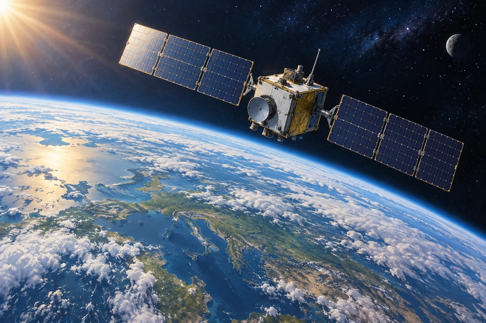

# Fermi-Aufgaben · Kreisbewegung Gravitation und Physikalische Weltbilder

## 18. Wie lange braucht ein Satellit für einen Umlauf?

Ein Satellit bewegt sich auf einer annähernd kreisförmigen Bahn 400 km über der Erdoberfläche. Wie lange benötigt er ungefähr für einen vollständigen Umlauf um die Erde?

### Arbeitsauftrag

Findet eine mögliche Antwort und entwickelt dazu euren eigenen Lösungsweg.

[Aufgabe öffnen](18-wie-lange-braucht-ein-satellit-fuer-einen-umlauf.html)
