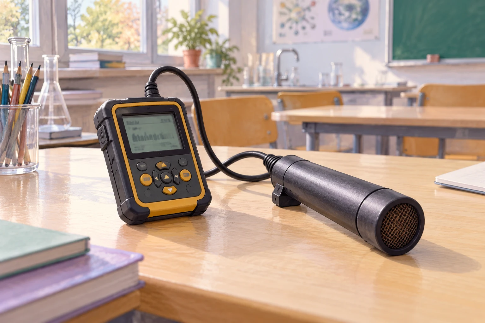

# Fermi-Aufgaben · Ionisierende Strahlung und Kernenergie

## 13. Wie viele Hintergrundimpulse zählt ein Geigerzähler?

Ein Geigerzähler steht in Raum 351 und misst ausschließlich die natürliche Hintergrundstrahlung. Wie viele Impulse registriert er ungefähr während eines sechsstündigen Schultags?

[Eigenen Lösungsweg entwickeln](13-wie-viele-hintergrundimpulse-zaehlt-ein-geigerzaehler.html#loesungsweg)
