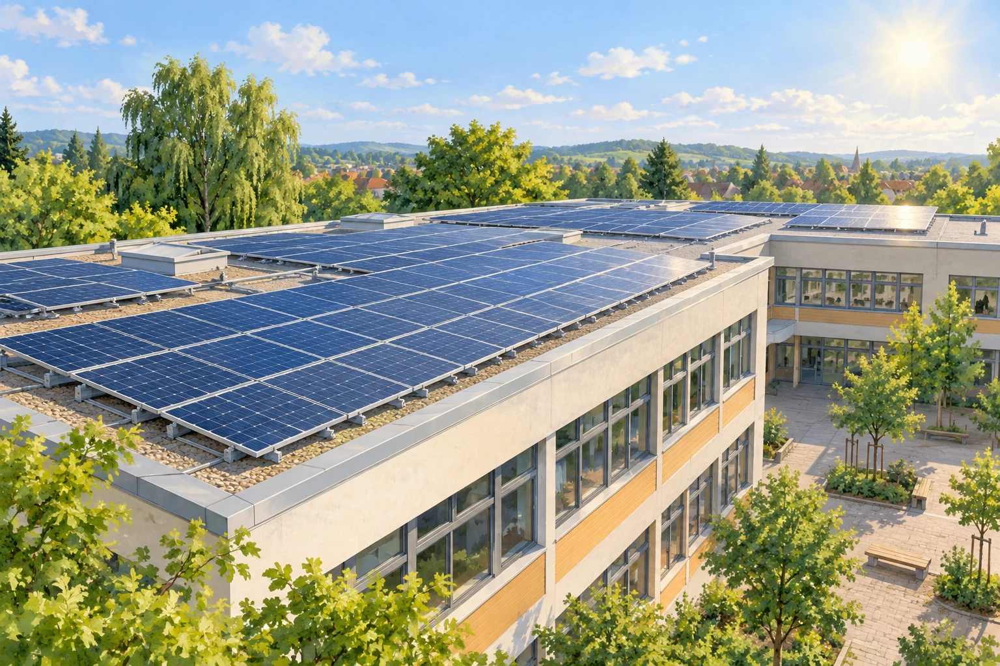

# Fermi-Aufgaben · Energieversorgung

## 14. Solarstrom für einen Schultag

Auf einem geeigneten Schuldach wird eine Photovoltaikanlage installiert. Wie viel elektrische Energie könnte sie an einem sonnigen Schultag innerhalb von sechs Stunden ungefähr erzeugen?

### Arbeitsauftrag

Findet eine mögliche Antwort und entwickelt dazu euren eigenen Lösungsweg.

[Aufgabe öffnen](14-solarstrom-fuer-einen-schultag.html)
