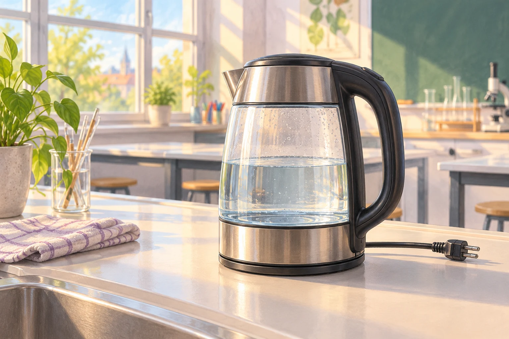

# Fermi-Aufgaben · Temperatur und Wärme

## 1. Wasser im Wasserkocher

Im Fachraum sollen 0,5 Liter Wasser im Wasserkocher von 20 °C auf 80 °C erwärmt werden. Wie viel Wärmeenergie benötigt das Wasser dafür ungefähr?

### Arbeitsauftrag

Findet eine mögliche Antwort und entwickelt dazu euren eigenen Lösungsweg.

[Aufgabe öffnen](01-wasser-im-wasserkocher.html)
