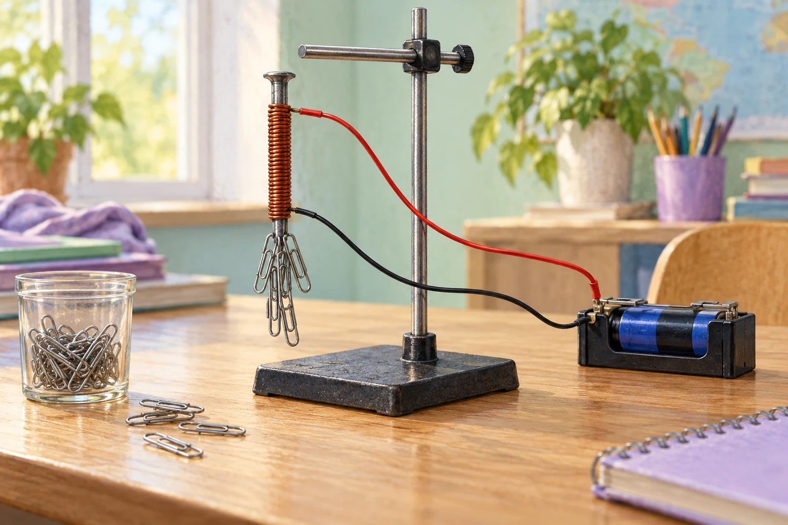

# Fermi-Aufgaben · Elektrischer Strom und Magnetismus

## 2. Wie viele Büroklammern hält der Elektromagnet?

Ein Elektromagnet im Fachraum wird mit einer Kleinspannungsquelle betrieben. Wie viele gewöhnliche Büroklammern kann er ungefähr gleichzeitig anheben?

[Eigenen Lösungsweg entwickeln](02-wie-viele-bueroklammern-haelt-der-elektromagnet.html#loesungsweg)
