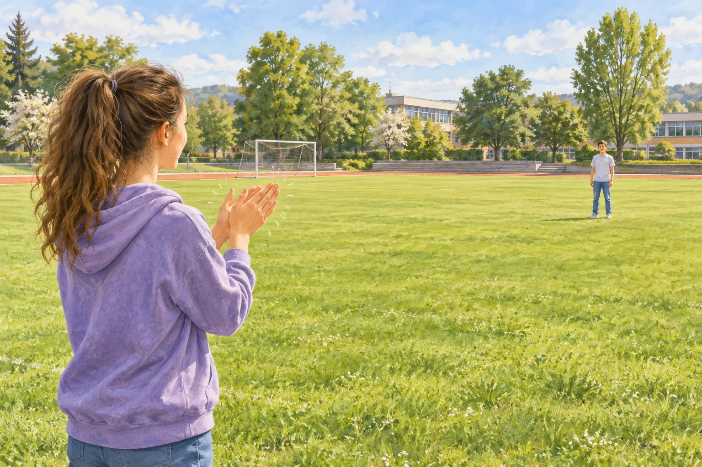

# Fermi-Aufgaben · Schall

## 3. Wie weit ist der Klatsch auf dem Sportplatz entfernt?

Auf dem Sportplatz klatscht eine Person in die Hände. Ihre Partnerin oder ihr Partner hört den Klatsch eine halbe Sekunde später. Wie weit stehen die beiden ungefähr auseinander?

### Arbeitsauftrag

Findet eine mögliche Antwort und entwickelt dazu euren eigenen Lösungsweg.

[Aufgabe öffnen](03-wie-weit-ist-der-klatsch-auf-dem-sportplatz-entfernt.html)
