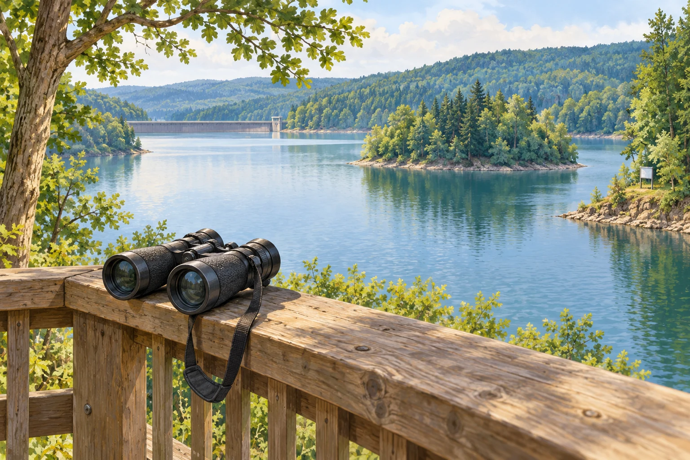

# Fermi-Aufgaben · Optische Instrumente

## 7. Was zeigt das Fernglas am Biggesee?

Am gegenüberliegenden Ufer des Biggesees steht ein 30 cm breites Schild. Ihr betrachtet es durch ein achtfach vergrößerndes Fernglas. Wie weit müsstet ihr ungefähr an das Schild herangehen, damit es mit bloßem Auge genauso groß erscheint?

### Arbeitsauftrag

Findet eine mögliche Antwort und entwickelt dazu euren eigenen Lösungsweg.

[Aufgabe öffnen](07-was-zeigt-das-fernglas-am-biggesee.html)
