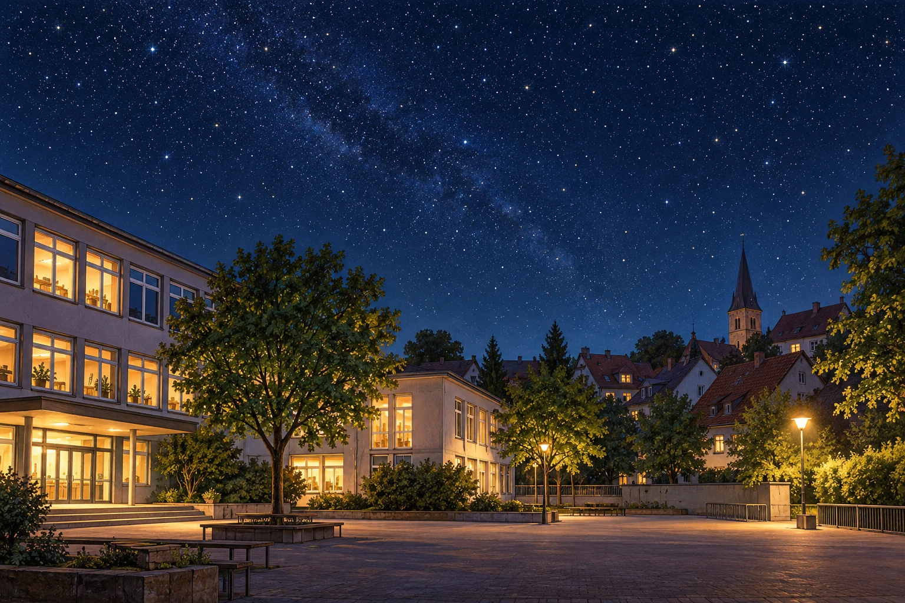

# Fermi-Aufgaben · Sterne und Weltall

## 8. Wie viele Sterne könnt ihr von Attendorn aus sehen?

Ihr steht an einem klaren, mondlosen Abend auf dem Schulhof des Rivius Gymnasiums. Wie viele Sterne könntet ihr dort gleichzeitig mit bloßem Auge sehen?

[Eigenen Lösungsweg entwickeln](08-wie-viele-sterne-koennt-ihr-von-attendorn-aus-sehen.html#loesungsweg)
