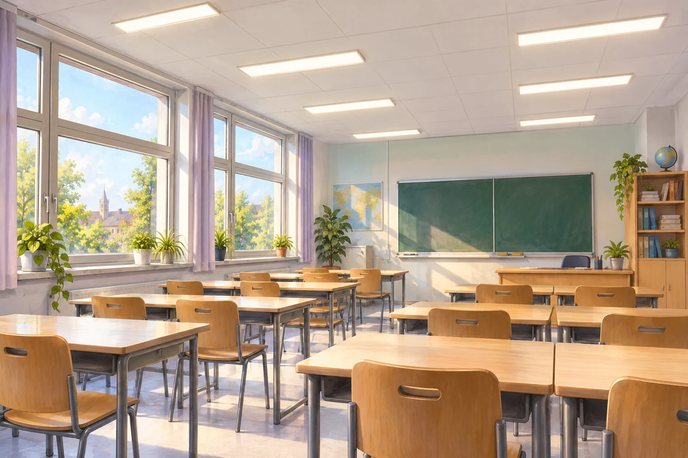
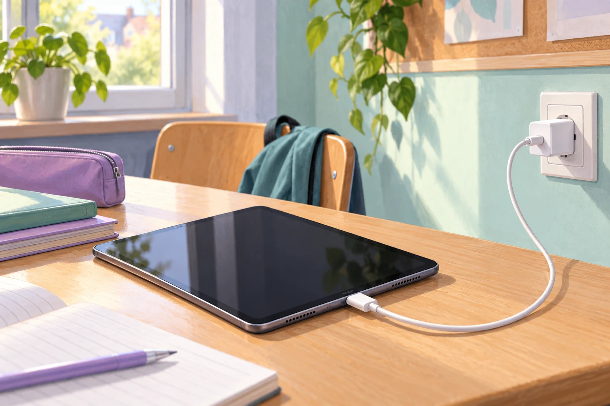

# Fermi-Aufgaben · Elektrizität

## 12. Energieverbrauch der Klassenraumbeleuchtung

Wie viel elektrische Energie benötigt die Beleuchtung in Raum 351 während einer normalen Schulwoche mit fünf Schultagen? Gebt eine ungefähre Energiemenge in Kilowattstunden an.

### Arbeitsauftrag

Findet eine mögliche Antwort und entwickelt dazu euren eigenen Lösungsweg.

[Aufgabe öffnen](12-energieverbrauch-der-klassenraumbeleuchtung.html)

## 15. Wie viel Strom verbraucht ein Tablet-Ladegerät in einer Schulwoche?

Ein Tablet wird an fünf Schultagen jeweils 90 Minuten lang geladen. Wie viel elektrische Energie nimmt sein Ladegerät dabei insgesamt ungefähr aus der Steckdose auf?

### Arbeitsauftrag

Findet eine mögliche Antwort und entwickelt dazu euren eigenen Lösungsweg.

[Aufgabe öffnen](15-wie-viel-strom-verbraucht-ein-tablet-ladegeraet-in-einer-schulwoche.html)

## 16. Wie viele Elektronen fließen beim Starten eines Kleinwagens?

Ein Kleinwagen wird morgens auf dem Schulparkplatz gestartet. Der Anlasser läuft dabei drei Sekunden lang. Welche Größenordnung hat die Anzahl der Elektronen, die in dieser Zeit durch den Anlasser fließen?

### Arbeitsauftrag

Findet eine mögliche Antwort und entwickelt dazu euren eigenen Lösungsweg.

[Aufgabe öffnen](16-wie-viele-elektronen-fliessen-beim-starten-eines-kleinwagens.html)
