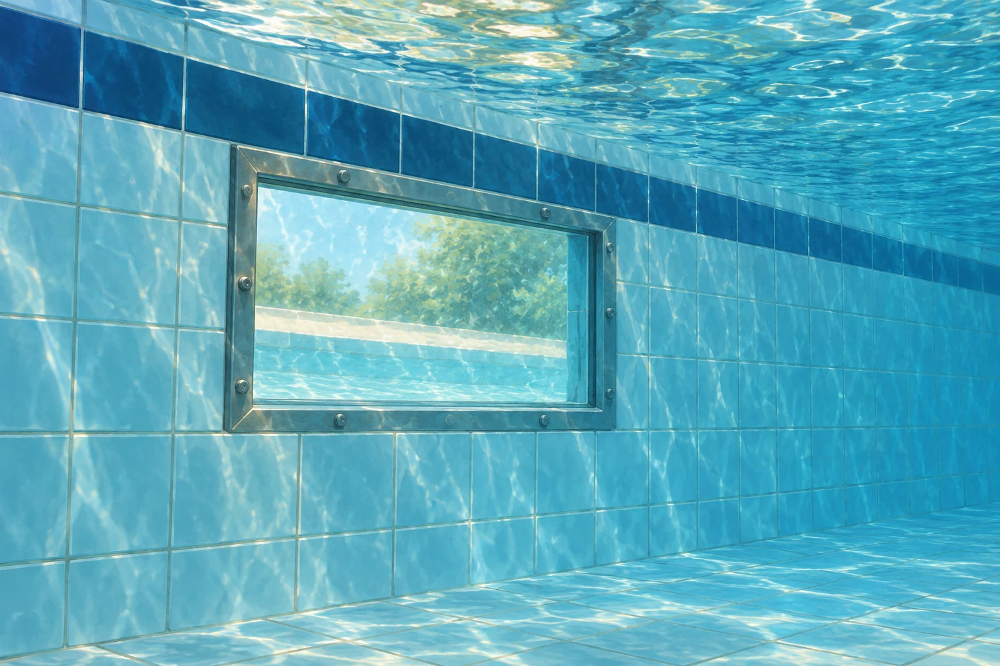

# Fermi-Aufgaben · Druck, Auftrieb und Strömung

## 10. Wie viel Wasser steckt im Biggesee?

Der Biggesee ist ein großer Stausee im Sauerland. Wie viele Tonnen Wasser enthält er ungefähr bei einem üblichen Wasserstand?

### Arbeitsauftrag

Findet eine mögliche Antwort und entwickelt dazu euren eigenen Lösungsweg.

[Aufgabe öffnen](10-wie-viel-wasser-steckt-im-biggesee.html)

## 11. Wie stark drückt Wasser auf eine Schwimmbadwand?

In einer Schwimmbadwand befindet sich ein 40 cm breites und 30 cm hohes Sichtfenster. Seine Mitte liegt 1,5 m unter der Wasseroberfläche; dahinter ist Luft bei normalem Umgebungsdruck. Mit welcher zusätzlichen Kraft drückt das Wasser ungefähr auf das Fenster?

### Arbeitsauftrag

Findet eine mögliche Antwort und entwickelt dazu euren eigenen Lösungsweg.

[Aufgabe öffnen](11-wie-stark-drueckt-wasser-auf-eine-schwimmbadwand.html)
