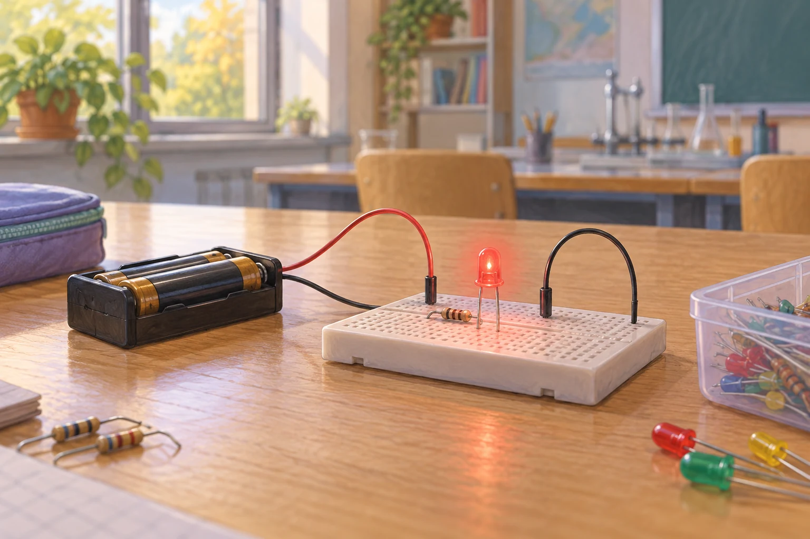

# Fermi-Aufgaben · Quantenobjekte

## 22. Photonen einer roten LED

Eine rote LED leuchtet mit einer elektrischen Leistungsaufnahme von ungefähr 0,1 Watt. Wie viele Photonen gibt sie ungefähr in einer Sekunde ab?

### Arbeitsauftrag

Findet eine mögliche Antwort und entwickelt dazu euren eigenen Lösungsweg.

[Aufgabe öffnen](22-photonen-einer-roten-led.html)

## 26. Wie viele Lichtquanten treffen während einer Stunde durch ein Fenster?

An einem sonnigen Tag fällt Licht durch ein Fenster in Raum 351. Wie viele sichtbare Photonen gelangen dort ungefähr während einer 45-minütigen Unterrichtsstunde durch das Fenster?

### Arbeitsauftrag

Findet eine mögliche Antwort und entwickelt dazu euren eigenen Lösungsweg.

[Aufgabe öffnen](26-wie-viele-lichtquanten-treffen-waehrend-einer-stunde-durch-ein-fenster.html)
