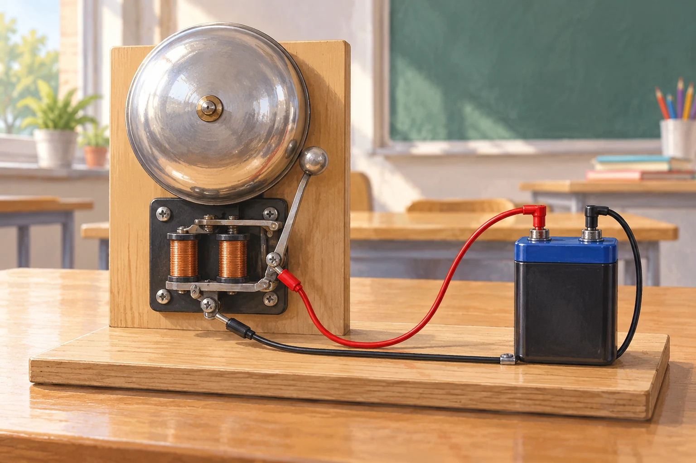

# Fermi-Aufgaben · Elektrodynamik und Energieübertragung

## 23. Wie viele Elektronen fließen beim Läuten der Schulglocke?

Eine mit Gleichstrom betriebene Schulglocke läutet drei Sekunden lang. Wie viele Elektronen passieren in dieser Zeit ungefähr einen Querschnitt ihrer Zuleitung?

### Arbeitsauftrag

Findet eine mögliche Antwort und entwickelt dazu euren eigenen Lösungsweg.

[Aufgabe öffnen](23-wie-viele-elektronen-fliessen-beim-laeuten-der-schulglocke.html)

## 24. Elektrische Energie aus einem Fahrraddynamo

Auf einer 20-minütigen Fahrt zur Schule versorgt ein Fahrraddynamo die eingeschaltete Fahrradbeleuchtung. Wie viel elektrische Energie liefert er in dieser Zeit ungefähr?

### Arbeitsauftrag

Findet eine mögliche Antwort und entwickelt dazu euren eigenen Lösungsweg.

[Aufgabe öffnen](24-elektrische-energie-aus-einem-fahrraddynamo.html)
