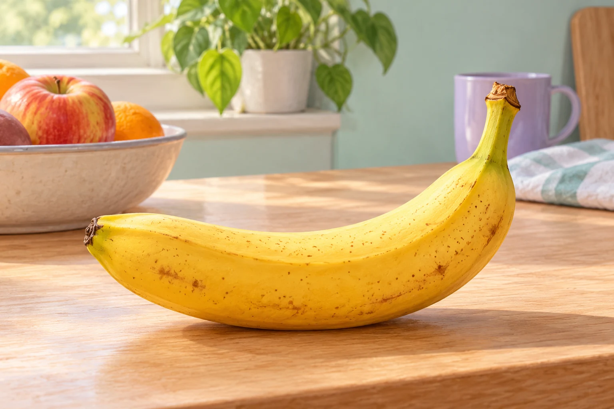

# Fermi-Aufgaben · Strahlung und Materie

## 25. Radioaktive Zerfälle im natürlichen Kalium

Eine Banane enthält natürliches Kalium und damit auch einen kleinen Anteil des radioaktiven Isotops Kalium-40. Wie viele Kalium-40-Zerfälle finden ungefähr an einem Tag in einer Banane statt?

### Arbeitsauftrag

Findet eine mögliche Antwort und entwickelt dazu euren eigenen Lösungsweg.

[Aufgabe öffnen](25-radioaktive-zerfaelle-im-natuerlichen-kalium.html)
