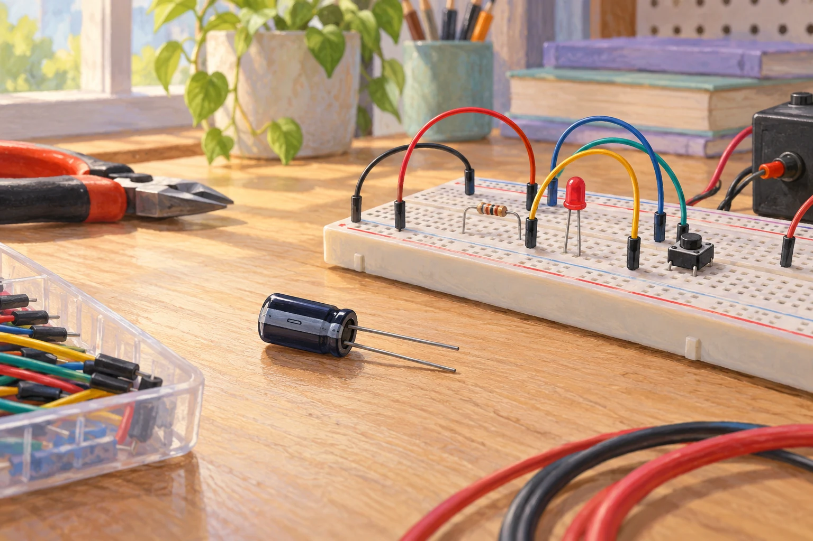

# Fermi-Aufgaben · Ladungen Felder und Induktion

## 27. Elektronen auf einer Kondensatorplatte

Ein Kondensator aus einem Schulversuch hat eine Kapazität von etwa 1000 µF und wird mit 5 V geladen. Wie viele zusätzliche Elektronen befinden sich dadurch ungefähr auf seiner negativ geladenen Platte?

[Eigenen Lösungsweg entwickeln](27-elektronen-auf-einer-kondensatorplatte.html#loesungsweg)
