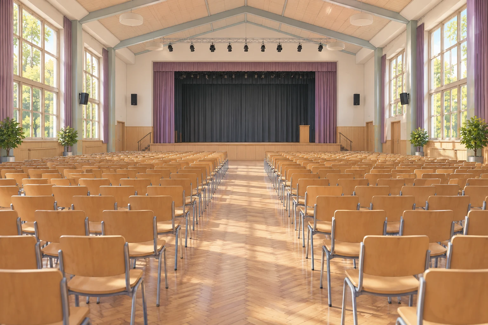
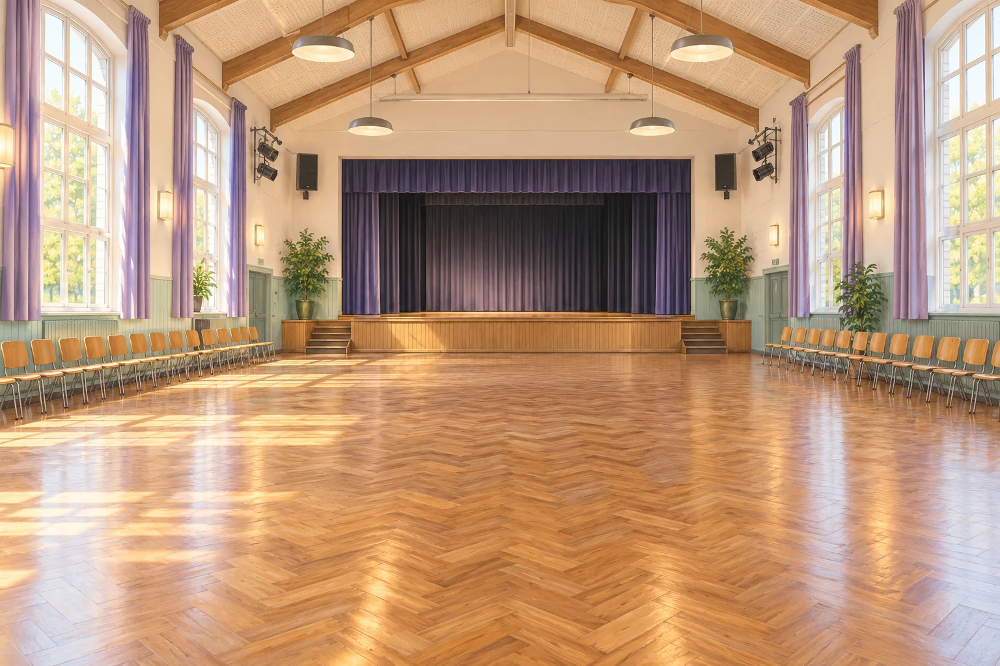

# Fermi-Aufgaben · Schwingende Systeme und Wellen

## 28. Grundton der Aula

Die Luft in der Aula kann zu stehenden Schallwellen angeregt werden. Welche tiefste Eigenfrequenz ergibt sich ungefähr, wenn ihr nur die längste Raumrichtung betrachtet?

[Eigenen Lösungsweg entwickeln](28-grundton-der-aula.html#loesungsweg)

## 31. Wie viele hörbare Eigenschwingungen passen in den Frequenzbereich der Aula?

Wie viele verschiedene stehende Schallwellen mit Frequenzen zwischen 20 Hz und 20 kHz sind ungefähr in der Aula möglich, wenn ihr nur Schwingungen entlang der längsten Raumrichtung betrachtet?

[Eigenen Lösungsweg entwickeln](31-wie-viele-hoerbare-eigenschwingungen-passen-in-den-frequenzbereich-der-aula.html#loesungsweg)
