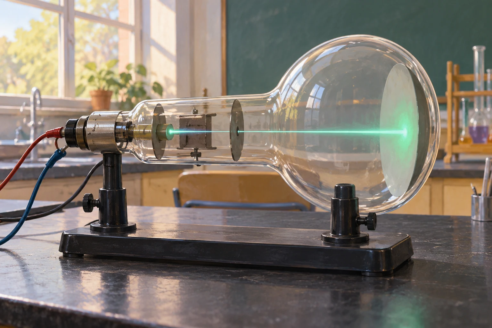

# Fermi-Aufgaben · Quantenphysik

## 29. Materiewellen im Elektronenstrahl

Ein Elektron wird durch eine Spannung von 100 V beschleunigt. Wie groß ist seine de-Broglie-Wellenlänge ungefähr, und wie oft passt diese Wellenlänge in die Breite eines menschlichen Haares?

### Arbeitsauftrag

Findet eine mögliche Antwort und entwickelt dazu euren eigenen Lösungsweg.

[Aufgabe öffnen](29-materiewellen-im-elektronenstrahl.html)
