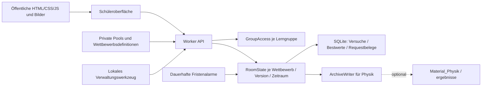

# Implementierte Architektur

## Bausteine

| Baustein | Aufgabe und Abgrenzung |
| --- | --- |
| `worker.mjs` | Strikte Methoden-/Feldprüfung, höchstens 16 KiB, CORS, Codeauthentifizierung bei jeder Anfrage, Auswahl der Definition und des Zeitraums |
| `GroupAccess` | SQLite-Tabelle für zufällige Personen-IDs, Pseudonyme, SHA-256-Codehashes, Sperren und minutenweise Ratenbegrenzung |
| `RoomState` | Transaktionale Spielzüge, höchstens ein aktiver Versuch pro Person, unveränderliche Definition, Bestwert, Aufräumen und Archivstand |
| `ArchiveWriter` | Dauerhafte Schreibaufträge, serielle GitHub-Aufrufe, Revisionsprüfung, SHA-Konfliktbehandlung und Wiederholungen |
| `spiel.mjs`, `zeitraum.mjs`, `vertrag.mjs` | Übernommener Physik-Regelkern mit Fragenwahl, Punkten, Leben, Berliner Monatsgrenzen und Datenvalidierung |
| `scripts/admin.mjs` | Getrennte Administration über einen starken Bearer-Schlüssel; keine Verwaltungsoberfläche im Schülerportal |

Es gibt keine laufende Abhängigkeit vom Fach Mathematik. Live-Daten stammen aus
Cloudflare; GitHub ist ein zusätzliches Ergebnisarchiv. Ein eigener Rechner muss
nach dem Deployment nicht eingeschaltet bleiben. Die [Durable-Object-Alarme](https://developers.cloudflare.com/durable-objects/api/alarms/)
wecken einen Raum für Fragefrist, Versuchsendfrist, Monatsabschluss, Archivwiederholung
oder tatsächlich anstehende Datenbereinigung. Ohne anstehende Arbeit wird der Alarm entfernt.

## Daten und Transaktionen

Die Namespaces verwenden Cloudflares SQLite-Backend. Die Adapter legen ihre Tabellen
idempotent an und tragen Schemaversion 1 in `schema_migrations` ein. Die ursprünglichen
SQL-Entwürfe unter `datenmodell/` bleiben Referenzmaterial; die Adapter benötigen keinen
manuellen SQL-Import. Spätere Änderungen müssen zusätzliche, versionierte Migrationen erhalten.

Ein Raum speichert Definition und Pool samt Fingerabdrücken einmalig. Die Spielauswahl
liegt im Versuch als privater Schnappschuss; der Browser erhält ausschließlich die
aktuell geöffnete Frage. Lösung und Erklärung werden erst nach der Auflösung ausgegeben.
Die Bindung umfasst Gruppe und Version. Neue Gruppen oder Regeln benötigen eigene
Definitionen; unpassende Definitionen derselben Version ergeben `409`.

`transactionSync` umfasst Fristprüfung, Fachaktion, Versuch, Bestwert und Requestbeleg.
Erwartete Fachfehler verlassen die Transaktion als Fehlerergebnis, sodass eine bereits
fällige Zeitüberschreitung erhalten bleibt. Die Punkte werden ausschließlich aus
Serverzeiten berechnet. Alarme und API-Aufrufe wenden dieselbe Fristlogik an.
Monatsgrenzen verwenden `Europe/Berlin`, einschließlich Sommer-/Winterzeit.

UUID-Requestbelege binden Personen-ID, API-Pfad und Inhalt. Derselbe Schlüssel liefert
die gespeicherte Wirkung, ein anderer Inhalt oder anderer Eigentümer führt zu `409`.
Auch nach der Belegaufbewahrung verhindern Fragezustand und aktiver Versuch Doppelwertungen.
Versuchszähler und Bestwerte liegen getrennt von den löschbaren Detailversuchen.

## API und Betrieb

Die Schülerpfade stammen aus dem ursprünglichen Vertrag. Der aktuelle maschinenlesbare
Vertrag für die tatsächlichen Antworten und Verwaltungsendpunkte liegt in
[`../api/openapi.json`](../api/openapi.json). Zusätzliche Erläuterungen stehen in [API.md](API.md).
Ranglisten geben nur Platz, Pseudonym, Punkte, Maximalpunkte und Abschlusszeit aus.
Codes, Hashes und interne Personen-IDs fehlen. Antworten sind `no-store`.

Das Frontend hält den Code nur im Arbeitsspeicher und fragt die Rangliste alle fünf
Sekunden ab. Bei Hintergrundwechsel pausiert das Polling; bei Rückkehr wird zuerst
der Serverstand geprüft. Netzfehler führen zu wachsenden Abfrageabständen. Buttons
sind während eines Spielzugs gesperrt; manuelle Wiederholungen nutzen denselben
Idempotenzschlüssel. Ein Neuladen erfordert erneute Codeeingabe und setzt eine aktive
Frist nicht zurück.

## Bewusste Änderungen gegenüber dem ZIP-Entwurf

- Ein Worker liefert Portal und API gemeinsam aus. Externe Pages-Nutzung bleibt möglich.
- Das Portal liegt entsprechend der Repositoryregeln im Themenfeld Optik unter `lernpfade/`.
- SQLite-Tabellen enthalten JSON-Schnappschüsse pro Versuch, statt die Entwurfs-SQL-Dateien unverändert zu übernehmen.
- Das GitHub-Archiv ist optional. Diese Arbeitskopie verwendet `Material_Physik/ergebnisse`
  und erlaubt öffentliche Ranglisten ausdrücklich mit `ARCHIVE_ALLOW_PUBLIC: "true"`.
  Ohne diese Freigabe werden öffentliche Repositories abgewiesen. Öffentliche Dateien
  enthalten ausschließlich eine Positivliste der Ranglisten- und Raumdaten.
  Bestwerte liegen auch bei deaktiviertem Archiv dauerhaft in Cloudflare.
- Formeln werden als Text ausgegeben. Ein Übungsmodus mit separater Fragenbank und KaTeX gehört nicht zu dieser ersten Umsetzung.
- Der Archivschreiber sammelt den ersten Auftrag 15 Sekunden; weitere noch offene Revisionen
  folgen frühestens 60 Sekunden nach Bestätigung. Schreibfehler werden nach mindestens
  15 Minuten erneut versucht; längere `Retry-After`-Vorgaben werden berücksichtigt.

Kein synchrones Live-Duell, keine Konten für Klarnamen und kein automatisches Importieren
alter Punktestände. Die vorhandenen Materialien
werden über die üblichen Repository-Builds eingebunden.
