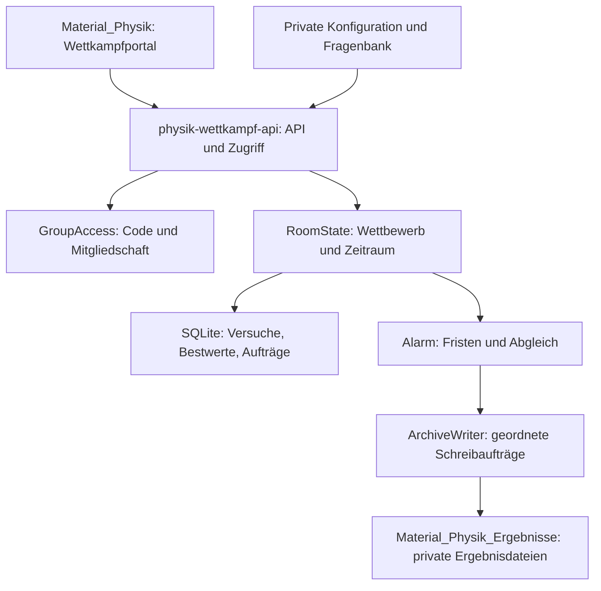

# Allgemeine Wettkampfarchitektur für Physik

## Ziel und Geltungsbereich

Ein Fachsystem betreibt beliebig viele konfigurierte Themenwettkämpfe in mehreren
Lerngruppen und Zeiträumen. Neue Themen benötigen im Grundfall einen neuen Fragenpool
und eine Konfiguration. Die Spielregeln müssen dafür nicht neu programmiert werden.
Beispiele für künftige Inhalte: Klasse 5: Wärme; Klasse 8: Optik; Klasse 10: Druck und Auftrieb; EF: Mechanik; Q1: Induktion.

Die vorliegende Fassung ist eine Architektur mit ausführbarem Regelkern. Die
Infrastrukturadapter und die allgemeine Benutzeroberfläche sind noch umzusetzen.
Die bisherige Quizumsetzung bleibt unverändert nutzbar.

## Eigenständige Bereitstellung

| Bestandteil | Festgelegte Zuordnung |
| --- | --- |
| Öffentliche Materialien und Wettkampfportal | `Hardenacke/Material_Physik` |
| Empfohlenes privates Serverrepository | `Hardenacke/Material_Physik_Wettkampf_API` |
| Worker der neuen Architektur | `physik-wettkampf-api` |
| Privates Ergebnisarchiv | `Hardenacke/Material_Physik_Ergebnisse` |
| Browserkennung | `material-physik-wettkampf-v1` |
| Fachkennung in jedem Vertrag | `physik` |
| Datenspeicher | Eigene GroupAccess-, RoomState- und ArchiveWriter-Namespaces |

Es gibt keine API-Aufrufe, Datenbankbindungen, Secrets, npm-Abhängigkeiten, Dateiverweise
oder Laufzeitimporte auf das andere Fach. Der Quelltext des Regelkerns wird in diesem
Paket bewusst vollständig mitgeliefert. Ein Update eines Fachs erzwingt kein Update
des anderen. Ein gemeinsames Cloudflare-Konto ist möglich; dann bleiben Anbieter und
kontoweite Grenzen gemeinsame Abhängigkeiten. Getrennte Speicherkennungen auf derselben
Pages-Domain verhindern versehentliche Vermischung, isolieren aber keine bösartigen Scripts.

## Bausteine und Datenfluss

**Portal:** Eine fachweite Einstiegsseite unter `wettkaempfe/index.html` mit
Wettkampfauswahl, Moduswahl, eigenem Spielstand, Bestwert und Rangliste. Themenmaterialien
können direkt auf einen Wettbewerb verlinken. Schüleransicht ohne Verwaltungsdetails.
Der Übungsmodus arbeitet weiter mit einer gesonderten öffentlichen Bank, drei Stufen,
Feedback und lokaler Statistik; Übungsergebnisse werden nicht in Wettkampfranglisten übertragen.

**API-Worker:** Prüft Methode, Ursprung, JSON-Vertrag, Nachrichtengröße und Code.
Er löst Fach, Wettbewerbsversion, Gruppe und Zeitraum aus seiner privaten Konfiguration
auf. Eine vom Browser mitgeschickte Punktzahl, Lebenszahl oder Antwortzeit wird abgewiesen.

**GroupAccess:** Ein Durable Object pro Lerngruppe und Fach. Enthält nur
Teilnehmende, Codehashes, Freigaben und Mitgliedschaften. 32 zufällige Bytes pro
persönlichem Code; Base64url-Ausgabe ausschließlich in einer privaten Lehrkraftliste.
Der Klartextcode wird nicht gespeichert und erscheint weder im Link noch im Archiv.
Die API lässt den Code mit SHA-256 hashen und prüft die konkrete Wettbewerbsmitgliedschaft.
Bei Sperrung muss jede weitere Anfrage abgewiesen werden; daher keine unbefristeten Authentifizierungscaches.

**RoomState:** Ein Durable Object pro
`physik/WETTKAMPF-ID/vVERSION/ZEITRAUM`. Es koordiniert ausschließlich diese Wertung.
Ein Raum enthält alle Versuche und Bestwerte seiner Teilnehmenden; dadurch sind
Versuchslimit, Wiederaufnahme, Punkte und Rangliste innerhalb einer Transaktion entscheidbar.
Es gibt keinen globalen Spielserver für alle Wettbewerbe.

**ArchiveWriter:** Ein eigener dauerhafter Schreiber dieses Fachs ordnet GitHub-Aufträge.
Die RoomState-Outbox und die Schreiberwarteschlange überstehen Neustarts. GitHub ist
das private Ergebnisarchiv; der Live-Spielstand stammt aus RoomState, nicht aus GitHub-Dateien.
Ein Ausfall des Archivs darf keine Antwortverarbeitung blockieren.

## Daten und Versionierung

| Begriff | Inhalt | Unveränderlich nach Veröffentlichung? |
| --- | --- | --- |
| Fragenpool | Fach, Jahrgang, Version, Aufgabenfamilien und Lösungen | Ja |
| Wettbewerb | Poolreferenz, Gruppe, Regelversion, Auswahl und Zeitfenster | Ja; Lebenszyklus separat |
| Zeitraum | `gesamt` oder lokaler Kalendermonat wie `2026-10` | Ja |
| Teilnahme | Pseudonym und Mitgliedschaft einer Person in der Lerngruppe | Sperrung/Codewechsel möglich |
| Versuch | Eigene ID, gespeicherte Fragenauswahl, Fristen, Leben, Punkte | Verlauf wird fortgeschrieben |
| Bestwert | Bester abgeschlossener Versuch einer Person in genau einer Wertung | Nur durch besseren Versuch ersetzen |
| Archivauftrag | Instanz-ID, Zielpfad, Revision und datensparsame Zusammenfassung | Inhalt je Revision fest |

Die veröffentlichte Konfiguration und der private Pool erhalten einen SHA-256-Fingerabdruck.
Der Definitionsfingerabdruck wird aus kanonischem JSON ohne das Feld `status` gebildet;
`fingerabdruck.mjs` stellt diese Berechnung bereit. Lebenszyklusänderungen erfolgen
separat, alle übrigen Definitionseigenschaften sind gebunden.
Im RoomState werden Konfigurations- und Poolfingerabdruck einmal gebunden. Startet der
Worker mit einer anderen Definition für dieselbe Version, weist er neue Spiele zurück,
bis eine neue Version verwendet wird. Laufende Versuche verwenden ihren gespeicherten
Regel- und Fragenschnappschuss. Ein reiner Serverneustart setzt nichts zurück.
Der Referenzkern speichert den Schnappschuss bereits; Fingerabdruckbindung ist Aufgabe des Adapters.

## Drei Veranstaltungsformen

| Form | Zeitraum | Versuche | Wertung |
| --- | --- | --- | --- |
| Klassenwettkampf | Festes Start- und Enddatum | Standard: einmal pro Person | Bester abgeschlossener Versuch |
| Dauerwettkampf | Ohne Enddatum, `continuous` | Beliebig oft, 30 Sekunden Abstand nach Ende | Persönlicher Bestwert in `gesamt` |
| Monatswettkampf | Dauerhaft erreichbar, `calendar-month` | Beliebig oft je Monat | Neuer Bestwert je Kalendermonat |

Diese Formen unterscheiden sich durch Daten, nicht durch unterschiedliche Spielseiten.
Die bereitgestellten Beispiele sind Entwürfe. Klassenwettkämpfe haben ein gemeinsames
Teilnahmefenster, aber weiterhin individuelle Fragebeginne. Ein zentral synchronisiertes
Duell mit identischer Frage zur selben Sekunde wäre ein zusätzliches Sitzungsmodul und
ist nicht Teil dieser Basisarchitektur.

## Spielablauf

1. Die Person meldet sich mit Gruppenkennung und persönlichem Code an. Nach serverseitiger
   Freigabe sieht sie die für sie zugänglichen Wettbewerbe und öffentlichen Regeln.
2. `attempts` ermittelt den Zeitraum nach Serverzeit. Ein vorhandener aktiver Versuch
   wird fortgesetzt; andernfalls werden Versuchslimit und Cooldown geprüft. Auswahl,
   Regelstand und Versuch werden zusammen gespeichert.
3. „Nächste Frage“ öffnet genau eine Frage. Erst jetzt setzt der Server `startedAt`
   und `deadline`; die Antwort enthält ausschließlich diese Frage und ihre Optionen.
4. Eine Antwort wird genau einmal ausgewertet. Richtig gibt Punkte; falsch oder zu spät
   kostet genau ein Leben. Bei 0 Leben oder nach allen Fragen endet der Versuch.
5. Ein fertiger Versuch aktualisiert gegebenenfalls den Bestwert. Laufende Versuche
   erscheinen nur im eigenen Spielstand beziehungsweise einer getrennten Aktivitätsanzeige,
   nicht als endgültige Platzierung.
6. Eine neue Teilnahme verwendet dieselbe Personenkennung und einen neuen Versuch.
   Ein schlechteres Ergebnis ersetzt den Bestwert nicht und wird nicht aufaddiert.

## Regeln, Fristen und Gleichstände

Die Standardregeln sind drei Leben, 60 Sekunden pro Frage und 100 Grundpunkte plus
bis zu 900 Zeitbonuspunkte. Für eine rechtzeitig richtige Antwort gilt:

$$P=100+\left\lfloor 900\max\left(0,1-\frac{t}{60000}\right)\right\rfloor.$$

Dabei ist $t$ die am Server gemessene Zeit in Millisekunden. Ab `now >= deadline`
gibt es null Punkte und ein Leben weniger. Nach 15 Sekunden gibt es 775, nach
30 Sekunden 550 Punkte. Ohne zusätzliche Bonusregel sind bei zwölf Fragen maximal
12.000 Punkte möglich. Übrige Leben geben keine Zusatzpunkte.

Zwischen Fragen darf pausiert werden; der gesamte Versuch endet spätestens 30 Minuten
nach seinem Start. Die Obergrenze ist konfigurierbar und verhindert unbegrenzt offene
Versuche. Eine bereits geöffnete Frage läuft bei Tabwechsel, Verbindungsverlust und
Neuladen weiter. Der Alarm wertet Zeitüberschreitungen auch ohne Browser aus; derselbe
Effekt wird bei einem verspäteten oder doppelten Alarm niemals noch einmal gebucht.

Gleiche Punktzahlen erhalten denselben Platz: 1, 1, 3. Alphabetische Reihenfolge dient
nur der Anzeige und entscheidet nicht über den geteilten Platz. Verschiedene Fächer,
Themen, Jahrgänge, Regelversionen und Zeiträume werden nicht in einer Punktetabelle vermischt.

## Monatswechsel und Abschluss

Maßgeblich ist `Europe/Berlin`, einschließlich Sommer- und Winterzeit. Der Monatsname
wird aus lokaler Zeit gebildet, die gespeicherte Grenze ist ein UTC-Zeitpunkt. Der
Oktober 2026 läuft beispielsweise von `2026-09-30T22:00:00Z` bis ausschließlich
`2026-10-31T23:00:00Z`. Es wird nicht mit festen 30-Tage-Intervallen gearbeitet.

Ein Versuch gehört immer zu seinem Startmonat. Seine harte Endfrist ist das Minimum
aus Versuchsdauer, Wettbewerbsende und Monatsende. Eine noch offene Frage verliert
bei Fristablauf einmal ein Leben, dann wird der vorhandene Punktestand abgeschlossen.
Noch nicht geöffnete Fragen werden nicht nachträglich als Fehler gezählt. Der fertige
Teilstand ist in diesem Zeitraum wertbar. Nach der Grenze ist ein neuer Versuch in
der neuen Monatswertung möglich; alte Antworten können keine neue Wertung verändern.

Es muss kein Lehrergerät laufen. Monatsgrenzen und Fristen werden dauerhaft als
Aufträge gespeichert. Alarme können verspätet eintreffen; deshalb prüfen auch alle
Requests die gespeicherten Grenzen. Die nächste Monatspartition darf beim ersten
Zugriff entstehen. Ein Abschlussalarm archiviert den alten Monat auch ohne Folgeteilnahme.

## Faire Aufgabenauswahl

Ein Wettbewerb fixiert Jahrgang, Fragenpoolversion, Stufenanteile, Fragenzahl, Zeiten
und Punkte. Die Referenz unterstützt `single-choice` mit einer richtigen Antwort.
Pro Versuch wird ohne Wiederholung eine Aufgabe je gewählter Aufgabenfamilie gezogen,
danach werden Reihenfolge und Optionen gemischt. Varianten derselben Familie werden
nicht mehrfach in einem Versuch verwendet. Die zufällige Auswahl geschieht privat am Server.

Gleiche Stufenanteile gewährleisten vergleichbare Regeln, aber noch keine empirisch
identische Schwierigkeit. Vor regelmäßigen Wettbewerben müssen Lehrkräfte die Aufgaben
fachlich prüfen. Die zwölf mitgelieferten Fragen sind ein Demonstrationspool und werden
bei der Standardauswahl vollständig verwendet. Für Wiederholungen zunächst beispielsweise
mindestens zwölf unabhängige Familien je Stufe bei vier gezogenen Aufgaben aufbauen.
Dieser Poolumfang ist ein Planungswert, keine technische Garantie gegen Auswendiglernen.

Formeln werden als Inhaltssegmente `type: math` mit LaTeX gespeichert. Die Oberfläche
rendert sie mit lokal eingebundenem KaTeX, `trust: false` und einer verständlichen
Fehlerdarstellung; normale Texte werden mit `textContent` ausgegeben. Die übernommenen
Altfragen sind als `text` markiert und behalten ihre bisherigen Unicode-Formeln.
Vor der neuen Oberfläche sollten Formelanteile in echte `math`-Segmente überführt werden.
Neue Aufgaben können dieses Format sofort verwenden. Erweiterungen auf Zahleneingaben,
Mehrfachauswahl oder Zeichnungen benötigen eigene Prüfer, Schemata und Vergleichsregeln.

## Konsistenz und Zugriff

Punkteänderung, Lebensverlust, Versuchsabschluss, Bestwert, Idempotenzbeleg und Outboxrevision
werden in einer SQLite-Transaktion geschrieben. Eine Bestätigung verlässt den Server erst
nach dauerhafter Speicherung. Vor einer Entscheidung werden fällige Fristen ausgewertet.
Ein partieller eindeutiger Index erlaubt nur einen aktiven Versuch pro Person und Wertung.

Jeder schreibende API-Aufruf trägt eine UUID im Header `Idempotency-Key`. Der Adapter
bindet sie an Teilnehmer-ID, Operation und Hash des Request-Bodys. Gleicher Schlüssel
und gleicher Inhalt geben das gespeicherte Ergebnis zurück; abweichender Inhalt wird
mit 409 abgewiesen. Eine alte Antwort-ID kann eine bereits gelöste Frage nicht erneut werten.
Die Referenz verhindert doppelte Fragewertung; die requestweite Idempotenz liegt im Adapter.

Leserechte auf Ranglisten erfordern ebenfalls Mitgliedschaft. Die API zeigt nur Pseudonym,
Punkte und Platz; persönliche Codes, Hashes und interne Personen-IDs werden nicht ausgegeben.
Jede Versuchsanfrage prüft die Eigentümerschaft. Ein Raumlink allein ist keine Anmeldung.
Administrationsrechte werden nie mit Schülercodes gleichgesetzt.

## Einordnung der technischen Quellen

GitHub Pages liefert statische HTML-, CSS- und JavaScript-Dateien. Die notwendige
private Auswertung ist deshalb als eigener Dienst geplant. Cloudflare dokumentiert
transaktionalen SQLite-Speicher und dauerhaft geplante Alarme für Durable Objects.
Die konkrete Aufteilung in Gruppen, Wertungsräume und Archivschreiber ist eine
Entwurfsentscheidung dieses Pakets. Sie ist keine Vorgabe des Anbieters.
Quellen und Abrufdatum stehen in `QUELLEN.md`.
